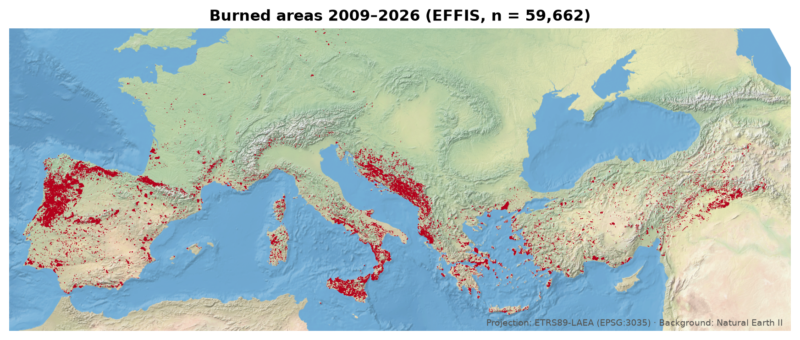
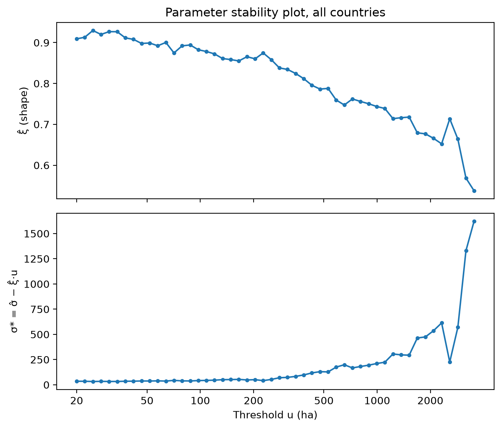
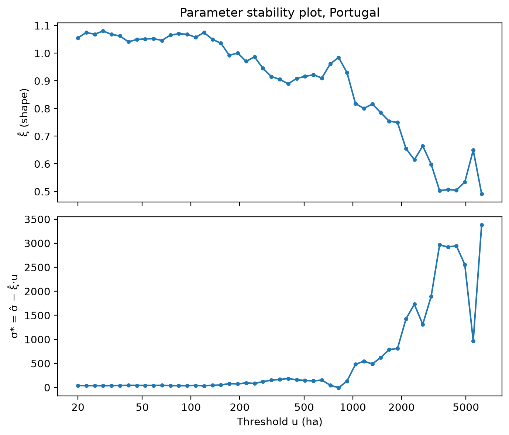
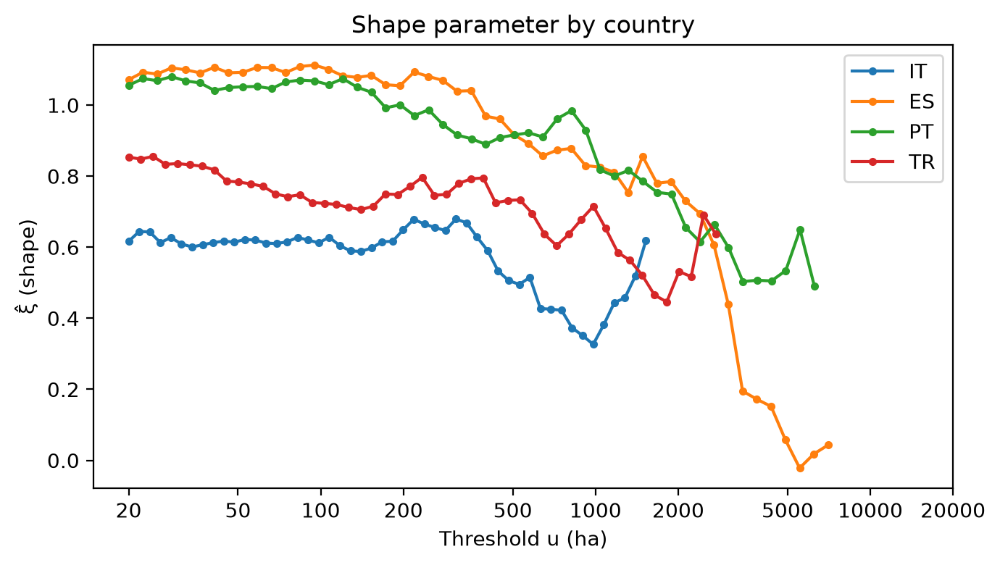

# Extreme Wildfires in Southern Europe (in progress)

Statistical analysis of extreme wildfire sizes in Mediterranean Europe (including Turkey) and the Alpine region, based on EFFIS burnt area data (2009–2026). The focus is the upper tail of the burned area distribution, modelled with Generalized Pareto distributions in a peaks-over-threshold framework.

## Data

- Source: [European Forest Fire Information System (EFFIS)](https://forest-fire.emergency.copernicus.eu/), burnt area polygons
- Region: 15 countries in Mediterranean Europe and the DACH region
- Period: 2009–2026
- Only fires larger than 20 ha are used, since EFFIS does not map smaller fires completely

The raw data is not included in this repository. To run the code, download the burnt areas from EFFIS and save the shapefile as `data/raw_data.shp`.

## Method

For a threshold u, the exceedances X − u of fires with X > u are fitted with a Generalized Pareto distribution GPD(ξ, σ) by maximum likelihood (`scipy.stats.genpareto`). The shape parameter ξ describes how heavy the tail is: ξ > 0 means that very large fires are much more likely than under an exponential tail.

The threshold is chosen with two standard diagnostics:

- **Mean excess plot:** e(u) = E[X − u | X > u] is linear in u above a threshold where the GPD holds (for ξ < 1).
- **Parameter stability plot:** above a valid threshold, ξ̂ and the modified scale σ* = σ̂ − ξ̂u should be approximately constant.

The analysis is done for the pooled data, for Portugal, and for the four countries with the most fires.

## First results

**All countries.** The estimated shape parameter is clearly positive, so the tail is heavy. However, ξ̂ does not stabilise: it decreases from about 0.9 at u = 20 ha to about 0.65 at u ≈ 2000 ha. A single GPD with constant shape does not describe the whole range, and the tail becomes lighter for the very largest fires.

**Portugal and country comparison.** For Portugal, ξ̂ is positive and decreases only slightly up to u ≈ 750 ha, but drops markedly above that. The other countries show a similar pattern, with Turkey and Italy having the most stable shape estimates. Without confidence intervals, these differences should be read with caution.

Two possible explanations for the decreasing ξ̂ are a physical tapering of the tail (very large fires are limited by landscape, fuel and suppression) and heterogeneity between regions with different fire regimes. Comparing single countries is a first step to separate the two.

## Limitations

- Fires in the same season and region are not independent, while the GPD fit assumes independent exceedances.
- For ξ ≥ 0.5 the variance of the GPD is infinite, so simple standard error bands for the mean excess are not reliable.
- No uncertainty quantification for ξ̂.

## Possible Extensions

- Bootstrap confidence intervals for ξ̂ and sensitivity analysis for the threshold
- Covariates in the GPD parameters: fire weather (FWI) and drought (SPEI)
- Machine learning baseline for the occurrence of extreme fires

## Code

`wildfire_gpd.py` reads the data, computes the threshold diagnostics and GPD fits, and saves all plots to `Figures/`. Requirements: `geopandas`, `numpy`, `scipy`, `matplotlib`.
